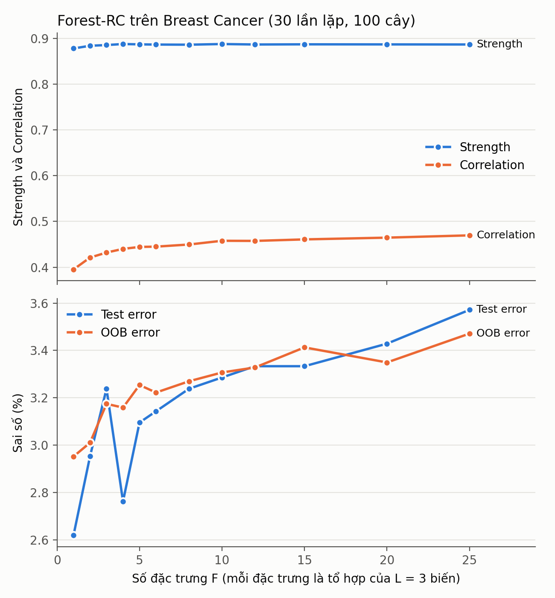

# TV1 (NPHieu) – Tái hiện Random Forests trên Breast Cancer Wisconsin

Folder này tái hiện các thí nghiệm của bài báo **Breiman, L. (2001). Random Forests.
Machine Learning, 45(1), 5–32** trên bộ dữ liệu Breast Cancer Wisconsin (Original):
Bảng 2 (Forest-RI), Bảng 3 (Forest-RC), so sánh với Adaboost, Bảng 4 (nhiễu nhãn),
strength/correlation và Hình 2.

Kết quả chính:

- Sai số test của Forest-RI (2.99%) và Forest-RC (2.93%) khớp với paper (2.9% và 3.1%).
- Số đặc trưng F nhỏ cho sai số thấp nhất: khi F tăng, strength gần như không đổi còn
  correlation tăng dần (tái hiện xu hướng của Hình 2).
- Forest-RI có sai số thấp hơn Adaboost 0.63 điểm % và khi thêm 5% nhãn nhiễu thì sai số
  tăng ít hơn Adaboost khoảng 3 lần.

## 1. Dữ liệu

| | |
|---|---|
| Tên | Breast Cancer Wisconsin (Original) |
| Nguồn | UCI Machine Learning Repository, Wolberg (1992): https://archive.ics.uci.edu/dataset/15/breast+cancer+wisconsin+original |
| File | `data/breast-cancer-wisconsin.data` (file gốc từ UCI, không chỉnh sửa) |
| Kích thước | 699 mẫu, 9 biến đầu vào, 2 lớp |
| Phân bố lớp | 458 lành tính, 241 ác tính |
| Biến đầu vào | 9 đặc điểm tế bào, đều là số nguyên từ 1 đến 10 |
| Giá trị thiếu | 16 giá trị, đều ở cột `bare_nuclei` (14 mẫu lành tính, 2 mẫu ác tính) |

## 2. Xử lý dữ liệu

1. Bỏ cột `id` vì không mang thông tin dự đoán.
2. Đổi ký hiệu `?` thành NaN.
3. Đổi nhãn: 2 (lành tính) thành 0, 4 (ác tính) thành 1.
4. Mỗi lần lặp, chia ngẫu nhiên 10% làm test (629 mẫu train, 70 mẫu test), không phân tầng
   (không stratify), dùng seed từ 0 đến 99.
5. Điền giá trị thiếu bằng trung vị của cột, tính **chỉ trên tập train** của lần chia đó, rồi
   áp dụng cho cả train và test. Tập test không tham gia tính trung vị nên không rò rỉ thông tin.
6. Không chuẩn hóa dữ liệu vì cả 9 biến cùng thang điểm 1–10.

## 3. Các file trong `code/`

| File | Nội dung |
|---|---|
| `data_loader.py` | Đọc file dữ liệu, thực hiện bước 1–3 ở trên, trả về `X`, `y`, tên biến. |
| `protocol.py` | Hàm `split_and_impute()`: chia 10% test theo seed và điền trung vị của train. |
| `forest_utils.py` | Forest-RI (dùng `RandomForestClassifier` của scikit-learn), bỏ phiếu đa số, OOB error, one-tree error, ước lượng strength và correlation. |
| `forest_rc.py` | Cây CART tự viết cho Forest-RC: tại mỗi nút sinh F đặc trưng, mỗi đặc trưng là tổ hợp tuyến tính của L biến với hệ số lấy từ U[-1, 1]. |
| `run_table2.py` | Bảng 2: Forest-RI với F = 1 và F = 4, lặp 100 lần. |
| `run_adaboost.py` | Adaboost 50 cây với độ sâu cây 1, 3, 5, 8 và không giới hạn, lặp 100 lần. |
| `run_table3.py` | Bảng 3: Forest-RC với L = 3, F = 2 và F = 8, lặp 100 lần. |
| `run_strength_corr.py` | Strength, correlation, c/s² và cận trên của sai số cho 4 cấu hình. |
| `run_table4_noise.py` | Bảng 4: ảnh hưởng của 5% nhãn nhiễu, lặp 50 lần. |
| `run_figure2.py` | Hình 2: Forest-RC với F từ 1 đến 25, chạy song song trên nhiều nhân CPU. |

Kết quả từng lần chạy được lưu trong `results/` (mỗi dòng CSV là một seed), hình vẽ lưu
trong `figures/`.

## 4. Cách chạy

Yêu cầu Python 3.11 trở lên. Mọi lệnh chạy từ trong folder `TV_NPHieu/`:

```
pip install -r requirements.txt
```

Chạy theo đúng thứ tự dưới đây. `run_table2.py` phải chạy trước `run_adaboost.py` và
`run_table3.py`, vì hai file này đọc `results/table2_forest_ri_runs.csv` để so sánh cặp
với Forest-RI.

| Thứ tự | Lệnh | Thời gian ước tính | File kết quả |
|---|---|---|---|
| 1 | `python code/run_table2.py` | khoảng 25 giây | `results/table2_forest_ri_runs.csv` |
| 2 | `python code/run_adaboost.py` | khoảng 20 giây | `results/adaboost_runs.csv` |
| 3 | `python code/run_table3.py` | 1–2 phút | `results/table3_forest_rc_runs.csv` |
| 4 | `python code/run_strength_corr.py` | 2–3 phút | `results/strength_correlation_runs.csv` |
| 5 | `python code/run_table4_noise.py` | 1–2 phút | `results/table4_noise_runs.csv` |
| 6 | `python code/run_figure2.py` | 1–5 phút | `results/figure2_rc_breast_runs.csv`, `figures/figure2_rc_breast.png` |

Có thể chạy `python code/data_loader.py` và `python code/protocol.py` để kiểm tra nhanh việc
đọc và chia dữ liệu.

## 5. Quy trình thực nghiệm

- Mỗi rừng gồm 100 cây, cây mọc tối đa, không cắt tỉa, tiêu chí Gini.
- Dự đoán bằng bỏ phiếu đa số, mỗi cây một phiếu; hòa phiếu thì chọn lớp 0. Không dùng
  `rf.predict()` vì scikit-learn lấy trung bình xác suất thay vì đếm phiếu.
- OOB error tự tính từ phiếu của các cây không chứa mẫu đó trong mẫu bootstrap.
- Cột "Selection": trong hai giá trị F, lấy sai số test của F có OOB error thấp hơn.
- Cột "One tree": sai số của từng cây trên các mẫu OOB của chính nó, lấy trung bình qua các cây.
- Forest-RI: F = 1 và F = int(log2 M + 1) = 4. Forest-RC: L = 3, F = 2 và F = 8.
- Adaboost: 50 cây. Paper không nêu độ sâu cây nên thử nhiều độ sâu.

## 6. Kết quả

Mọi con số dưới đây tính từ các file CSV trong `results/`. Sai số tính bằng %, viết dưới dạng
trung bình ± sai số chuẩn (SE) qua các lần lặp.

### Bảng 2 – Forest-RI (100 lần lặp)

| Cột | Nhóm | Paper |
|---|---|---|
| Selection | 2.99 ± 0.21 | 2.9 |
| Single input (F = 1) | 2.99 ± 0.21 | 2.7 |
| One tree | 6.17 ± 0.04 | 6.3 |

OOB error chọn F = 1 trong 97/100 lần. Sai số test trung bình là 2.99% với F = 1 và 3.61% với
F = 4 (chênh 0.63 ± 0.13 khi so sánh cặp theo seed).

### Bảng 3 – Forest-RC (100 lần lặp)

| Cột | Nhóm | Paper |
|---|---|---|
| Selection | 2.93 ± 0.20 | 3.1 |
| Two features (F = 2) | 2.87 ± 0.20 | 2.9 |
| One tree | 5.79 ± 0.03 | 5.8 |

OOB error chọn F = 2 trong 83/100 lần. Sai số test trung bình là 2.87% với F = 2 và 3.07% với
F = 8 (chênh 0.20 ± 0.10). Forest-RC và Forest-RI không khác nhau rõ rệt: hiệu cột Selection
là −0.06 ± 0.11.

### Adaboost (50 cây, 100 lần lặp)

| Độ sâu cây | Sai số test | Số cây thực tế (trung bình) |
|---|---|---|
| 1 | 4.50 ± 0.23 | 50.0 |
| 3 | 4.11 ± 0.23 | 50.0 |
| 5 | 3.61 ± 0.22 | 50.0 |
| 8 | 5.26 ± 0.27 | 3.8 |
| Không giới hạn | 6.23 ± 0.29 | 1.0 |

Paper báo cáo 3.2%. Độ sâu 5 cho sai số thấp nhất, vẫn cao hơn Forest-RI 0.63 ± 0.14 điểm %
(so sánh cặp theo seed). Với cây sâu 8 hoặc không giới hạn, cây đầu tiên đã khớp gần hết tập
train nên Adaboost dừng sớm và gần như chỉ còn một cây.

### Bảng 4 – 5% nhãn nhiễu (50 lần lặp)

Đổi ngẫu nhiên 5% nhãn của tập train (31/629 mẫu) sang lớp còn lại; tập test giữ nhãn sạch.
Cấu hình: Adaboost cây độ sâu 5, Forest-RI F = 1, Forest-RC F = 2.

| Phương pháp | Nhãn sạch | Nhãn nhiễu | Tăng (điểm %) | Tăng tương đối | Paper (tương đối) |
|---|---|---|---|---|---|
| Adaboost | 3.46 | 4.63 | +1.17 ± 0.30 | 33.9% | 43.2% |
| Forest-RI | 2.71 | 3.09 | +0.37 ± 0.20 | 13.7% | 1.8% |
| Forest-RC | 2.74 | 3.17 | +0.43 ± 0.21 | 15.6% | 11.1% |

Sai số của Adaboost tăng nhiều hơn Forest-RI 0.80 ± 0.34 điểm % (so sánh cặp), tức gấp khoảng
3 lần.

### Strength và correlation (100 lần lặp)

| Cấu hình | Strength s | Correlation ρ | c/s² | Cận trên của sai số | Sai số test | OOB error |
|---|---|---|---|---|---|---|
| Forest-RI, F = 1 | 0.877 | 0.403 | 0.524 | 12.1% | 2.99 | 3.12 |
| Forest-RI, F = 4 | 0.876 | 0.452 | 0.588 | 13.7% | 3.61 | 3.81 |
| Forest-RC, F = 2 | 0.883 | 0.421 | 0.539 | 11.9% | 2.87 | 2.99 |
| Forest-RC, F = 8 | 0.886 | 0.454 | 0.578 | 12.4% | 3.07 | 3.27 |

Strength và correlation ước lượng bằng OOB theo Phụ lục II của paper. Cận trên của sai số là
ρ(1 − s²)/s² (Định lý 2.3). Cận này lỏng (12–14% so với sai số thực khoảng 3%), nhưng trong
cùng một phương pháp, cấu hình có c/s² thấp hơn cũng có sai số test thấp hơn.

### Hình 2 – Forest-RC khi F thay đổi (30 lần lặp)



| F | Strength | Correlation | Sai số test | OOB error |
|---|---|---|---|---|
| 1 | 0.878 | 0.395 | 2.62 | 2.95 |
| 25 | 0.887 | 0.470 | 3.57 | 3.47 |

Khi F tăng từ 1 đến 25, strength gần như đứng yên còn correlation tăng đều, nên sai số tăng
theo. Đường sai số test gồ ghề (ví dụ điểm F = 4) vì chỉ có 30 lần lặp: sai số chuẩn của mỗi
điểm khoảng 0.4 điểm %. Đường OOB error mượt hơn và cho cùng xu hướng.

## 7. Khác biệt so với paper

- **Cài đặt cây.** Forest-RI dùng cây CART của scikit-learn, khác cài đặt gốc của Breiman. Ví dụ,
  khi F biến được chọn không cho phép chia nào hợp lệ, scikit-learn xét tiếp các biến khác.
- **Giá trị thiếu.** Paper không nói cách xử lý 16 giá trị thiếu; nhóm điền bằng trung vị của
  tập train.
- **Cột One tree của Bảng 2.** Nhóm đo được 6.17 so với 6.3 của paper. Chênh lệch nhỏ (0.13
  điểm %) nhưng lớn hơn 2 SE vì SE của cột này chỉ 0.04. Các cột còn lại của Bảng 2 và Bảng 3
  đều lệch dưới 2 SE.
- **Độ sâu cây của Adaboost.** Paper không nêu độ sâu. Nhóm chọn độ sâu 5 theo sai số test, nên
  con số 3.61% hơi lạc quan cho Adaboost; kết luận Forest-RI tốt hơn vì thế không bị ảnh hưởng.
- **Bảng 4, Forest-RI.** Mức tăng tương đối nhóm đo được (13.7%) cao hơn paper (1.8%). Với 50
  lần lặp, mức tăng +0.37 ± 0.20 điểm % chưa khác 0 một cách rõ rệt, nên không kết luận được
  hai con số này mâu thuẫn. Adaboost vẫn là phương pháp tăng sai số nhiều nhất, giống paper.
- **Hình 2.** Paper lặp 80 lần với mọi F từ 1 đến 25; nhóm lặp 30 lần trên 12 giá trị F.
  Correlation đo được cao gấp khoảng 2 lần so với Hình 2 của paper, xu hướng theo F vẫn khớp.
- **Dòng trùng.** Dữ liệu có 8 dòng trùng hoàn toàn. Một mẫu test có thể có bản sao trong tập
  train, làm sai số test thấp hơn thực tế một chút.
- **Lỗi in trong bản PDF của paper.** Mục 1.1 ghi bagging lấy mẫu "without replacement" (đúng ra
  là có hoàn lại); công thức sd ở Phụ lục II in dấu "+" (đúng ra là dấu trừ, code dùng dấu trừ).

## 8. Tài liệu tham khảo

- Breiman, L. (2001). Random Forests. *Machine Learning*, 45(1), 5–32.
- Wolberg, W. H. (1992). Breast Cancer Wisconsin (Original). UCI Machine Learning Repository.
  https://archive.ics.uci.edu/dataset/15/breast+cancer+wisconsin+original
